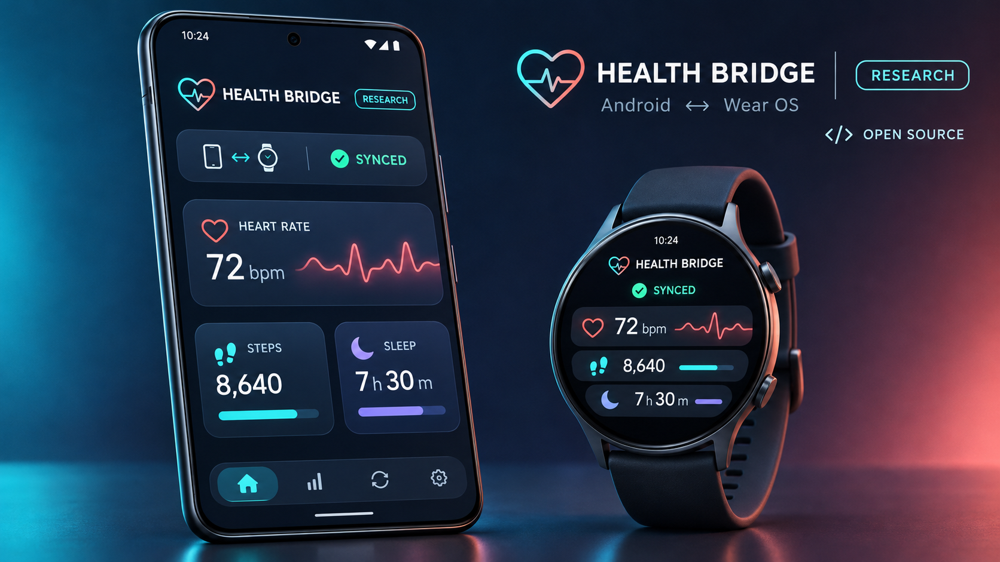
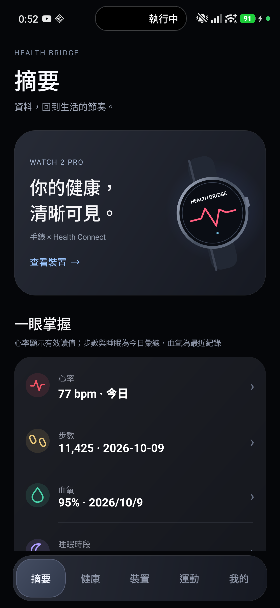

# Xiaomi Health Bridge

[繁體中文](README.md) | [English](README.en.md)

Xiaomi Health Bridge is an open-source Android phone + Wear OS research project by **王宥傑 (Wang You-Jie)**. It builds an auditable health-data path between Xiaomi Watch 2 Pro and Android: acquire data on the watch, retain provenance and quality evidence, synchronize through the Wearable Data Layer, persist on the phone, and write supported records to Health Connect.



> The hero is a privacy-safe illustrative mockup. Actual features and support depend on the source, device capabilities, and `SUPPORT_MATRIX.md`.

Current version: `3.13.44` (versionCode `154`). The source tree contains:

- `mobile/` — Android phone app
- `wear/` — Wear OS watch app
- `health-engine/` — shared classification, quality, and research-analysis core
- `research/clinical-data/` — reproducible offline public-dataset benchmarks; datasets are not redistributed



All screenshots are demo screens containing no personal data. More examples: [summary navigation](docs/images/mobile-summary-navigation-demo.png), [health metrics](docs/images/mobile-health-grid-demo.png), and [ECG research limitations](docs/images/ecg-research-limitations-demo.jpg).

## What it does

- Uses Wear OS Health Services for supported heart-rate and activity data.
- Synchronizes watch and phone through Google Play services Wearable Data Layer.
- Reads and writes supported Health Connect records on the phone.
- Separates missing, stale, poor-quality, unsupported, and sync-failed states.
- Preserves research evidence for ECG, PPG, BioZ, raw SpO₂, temperature, and motion channels.
- Unlocks an interpreted result only when its units, timing, mapping, quality, and calibration requirements pass.
- Includes offline ECG/PPG method benchmarks against public datasets.

## Medical disclaimer

This is a research and personal-development tool, **not a medical device**. It is not intended for diagnosis, treatment, disease prevention, emergency monitoring, or medication decisions. Public datasets and papers can evaluate a method or provide context; they cannot establish Xiaomi Watch 2 Pro hardware calibration, clinical accuracy, or an individual's health status.

ECG remains research-only unless device-specific lead mapping, ADC timing, and raw-code-to-mV calibration are verified. Without that evidence, the project exposes only raw or normalized index-domain information and does not produce mV, RR, HRV, AFib, or diagnostic claims.

## APKs

The GitHub Release provides matching sideloadable Debug builds:

- `XiaomiHealthBridge-Mobile-3.13.44-vc154-debug.apk` — Android phone
- `XiaomiHealthBridge-Wear-3.13.44-vc154-debug.apk` — Xiaomi Watch 2 Pro / compatible Wear OS device

Debug APKs use an Android development signature and are not Play Store releases. Production Release APKs are not distributed because no authorized release keystore was supplied. Verify the SHA-256 values published in the Release before installation.

## Build

Requirements: JDK 17, Android SDK 36, Google Maven, and Maven Central access.

```powershell
.\gradlew.bat :health-engine:test :mobile:testDebugUnitTest :wear:testDebugUnitTest
.\gradlew.bat :mobile:assembleDebug :wear:assembleDebug
```

Outputs are `mobile/build/outputs/apk/debug/mobile-debug.apk` and `wear/build/outputs/apk/debug/wear-debug.apk`. Local SDK settings, Gradle caches, build output, downloaded research data, and signing material are excluded from Git.

## External data and literature

See [THIRD_PARTY_NOTICES.md](THIRD_PARTY_NOTICES.md) for the complete purpose, limits, licenses, and citations. Principal offline references include PhysioNet ECG-ID, MIT-BIH Noise Stress Test Database, MIT-BIH Arrhythmia Database, Wrist PPG During Exercise, and optional PTB-XL comparisons. None is bundled in the source or APKs, and none provides device calibration.

For a one-to-one dataset → paper → algorithm → implementation map, see [`docs/ALGORITHM_DATASET_PAPER_MAP.md`](docs/ALGORITHM_DATASET_PAPER_MAP.md).

## Privacy and evidence boundaries

- The project does not scrape or redistribute the private Mi Fitness database.
- Raw research evidence stays in app-private storage by default.
- The repository excludes personal health exports, device/account identifiers, network addresses, signing keys, and dataset copies.
- Unknown is not rendered as zero; estimated is not presented as measured; raw code is not presented as a physiological unit.

## License

Original project code is available under the [MIT License](LICENSE). Dependencies, datasets, publications, standards, vendor documents, and trademarks retain their own terms. This independent project is not endorsed by Xiaomi, Google, Android, Wear OS, PhysioNet, or the cited institutions.

Author: **王宥傑 (Wang You-Jie)**.
