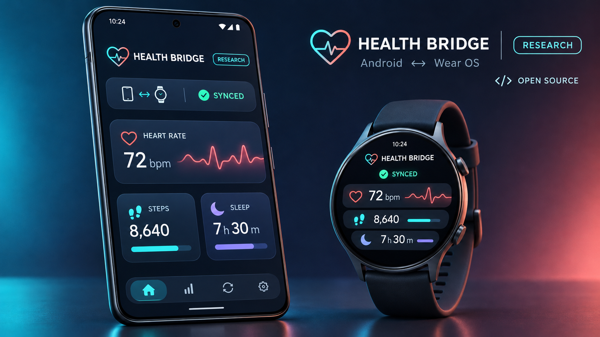
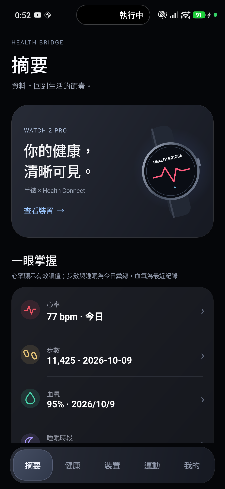

# AILISA Health Bridge

[繁體中文](README.md) | [English](README.en.md)

AILISA Health Bridge 是一個 Android 手機 + Wear OS 雙端開源研究專案，目標是在 Xiaomi Watch 2 Pro 與手機之間建立可稽核的健康資料流程：手錶取得資料、保留來源與品質證據、透過 Wearable Data Layer 同步、由手機保存並在適用時寫入 Health Connect。

本專案由王宥傑獨立開發，與小米公司及 Mi Fitness 沒有官方關聯，也未獲其認可或贊助。Xiaomi Watch 2 Pro 僅用於指明研究與測試的相容裝置。



> 上圖為不含真實個資的示意圖；實際功能與支援項目以原始碼、裝置能力及 `SUPPORT_MATRIX.md` 為準。

目前測試版本：`4.0.0` test 17（雙端 Debug versionCode `169`）。原始碼同時包含：

- `mobile/`：Android 手機 App
- `wear/`：Wear OS 手錶 App
- `health-engine/`：共用資料分類、品質與研究分析核心
- `research/clinical-data/`：離線、可重現的公開資料集基準工具；資料集本身不隨專案散布



以上及下列畫面皆為示範資料，不含個人資料。更多畫面：[導覽摘要](docs/images/mobile-summary-navigation-demo.png) · [健康指標](docs/images/mobile-health-grid-demo.png) · [ECG 研究限制](docs/images/ecg-research-limitations-demo.jpg)。

## 這個專案能做什麼

- 使用 Wear OS Health Services 量測或接收裝置支援的心率、活動等資料。
- 經 Google Play services Wearable Data Layer 在手錶與手機間同步。
- 在手機端讀寫支援的 Health Connect 紀錄。
- 顯示來源、時間、新鮮度、品質、校準與同步狀態，區分「無資料」「過期」「品質不足」「不支援」與「同步失敗」。
- 保存 ECG、PPG、BioZ、原始 SpO₂、溫度與動作感測研究證據；只有在單位、時基、映射、品質與校準條件成立時才解鎖相應結果。
- 提供公開 ECG／PPG 資料庫的離線比較與演算法基準工具。
- 4.0 新增血氧手動／主動／自動紀錄方式篩選，以及手錶上由使用者點擊的原廠功能入口；原廠是否啟用仍以原廠畫面為準。
- test 14 依原廠手錶程式釐清「呼吸練習」是引導式練習，新增手錶首頁入口；它與 BioZ 呼吸速率研究分開，不將練習心率當作呼吸率。
- test 15 依已安裝原廠程式的血氧及體溫流程改善量測前提示，並[逐步對照原廠服務結果與 Android 原始事件](docs/OEM_SPO2_TEMPERATURE_SOURCE_TRACE.md)；原始值仍不冒充百分比或攝氏溫度。
- test 16 對照原廠壓力服務與本專案 HRV 研究分數，提供由使用者點擊的原廠壓力頁入口；不把兩種結果混為一談。
- test 17 對照 Mi Fitness 手動血壓／血糖紀錄路徑，修正誤導性的光學血壓標籤，並阻止舊光學估值以 mmHg 顯示；手機僅記錄外部袖帶讀值。

## 重要醫療聲明

本專案是研究與個人開發工具，不是醫療器材，不用於診斷、治療、預防疾病或緊急監測。公開資料庫與論文只能驗證方法或提供比較背景，不能證明 Xiaomi Watch 2 Pro 的硬體校準、臨床準確度或特定個人的健康狀況。

目前 ECG 仍屬研究用途：若導聯映射、ADC 時脈與 raw-code→mV 校準沒有裝置專屬證據，系統只呈現原始／正規化索引域資訊，不輸出 mV、RR、HRV、AFib 或診斷結論。不要用本 App 的輸出取代醫師、經核准的醫療設備或緊急服務。

## APK 安裝

4.0.0 test 18 雙端測試 APK 可由 [ailisa.net 下載頁](https://ailisa.net/portfolio/ailisa-health-bridge#downloads) 或 [GitHub Release](https://github.com/jay19821026-dev/Watch2/releases/tag/v4.0.0-test.18) 下載：

- `AILISAHealthBridge-Mobile-4.0.0-vc172-test18-debug.apk`：安裝到 Android 手機
- `AILISAHealthBridge-Wear-4.0.0-vc172-test18-debug.apk`：安裝到 Xiaomi Watch 2 Pro／相容 Wear OS 裝置
- `AILISAHealthBridge-Legacy-Migration-Bridge-vc172-test18-debug.apk`：先覆蓋安裝在舊版手機 App，以搬遷加密紀錄

Debug APK 使用 Android 開發用簽章，適合側載測試，不是正式商店發行版。新套件識別碼為 `net.ailisa.healthbridge`，會與舊版並存；請先讀[搬遷指南](docs/PACKAGE_MIGRATION_4_0.en.md)，不要解除安裝舊版。先前 test 17 的本機簽署 Play 候選 AAB 屬於舊套件，不可當作新版上傳。安裝前請核對 [test 18 SHA-256](https://github.com/jay19821026-dev/Watch2/releases/download/v4.0.0-test.18/SHA256SUMS-4.0.0-test.18.txt)；詳見[中英文安裝與測試說明](docs/4.0_TEST_INSTALL.md)。

專案也提供 PowerShell 安裝腳本；它會建置目前版本、檢查套件名稱／版本／簽章，再以 `adb install -r` 保留既有 App 資料：

```powershell
.\install-apks.ps1 -WatchAddress "手錶IP:ADB連接埠"
```

## 從原始碼建置

需求：JDK 17、Android SDK（compile/target SDK 36），以及可存取 Google Maven 與 Maven Central 的網路。

```powershell
.\gradlew.bat :health-engine:test :mobile:testDebugUnitTest :wear:testDebugUnitTest
.\gradlew.bat :mobile:assembleDebug :wear:assembleDebug
```

輸出：

- `mobile/build/outputs/apk/debug/mobile-debug.apk`
- `wear/build/outputs/apk/debug/wear-debug.apk`

`local.properties`、Gradle 快取、建置輸出、研究原始資料與簽章檔不會提交到 GitHub。

## 外部資料、論文與技術來源

完整用途、限制、授權與引用請見 [THIRD_PARTY_NOTICES.md](THIRD_PARTY_NOTICES.md)。核心原則如下：

資料庫 → 論文 → 演算法 → 實際程式檔案的一對一對照，請見 [`docs/ALGORITHM_DATASET_PAPER_MAP.md`](docs/ALGORITHM_DATASET_PAPER_MAP.md)。

Mi Fitness 9.8.348i 的 clean-room 靜態反組譯、資料管線差異、可合法借鏡功能與不可重用的專有邊界，請見 [`docs/MI_FITNESS_9_8_348I_REVERSE_ENGINEERING_COMPARISON.md`](docs/MI_FITNESS_9_8_348I_REVERSE_ENGINEERING_COMPARISON.md)。反組譯原始碼、模型與原生程式庫未納入本儲存庫。

新提供的 Mi Fitness 3.53.0i XAPK 與 9.8.348i 對照，包含 Health Connect 寫入路徑、ECG 卡片條件、資料表差異與可採用的官方資料分享方式，見 [`docs/MI_FITNESS_3_53_0I_XAPK_COMPARISON.md`](docs/MI_FITNESS_3_53_0I_XAPK_COMPARISON.md)。

已安裝的 Mi Fitness 3.59.2i 如何解析、驗證、儲存與顯示原廠 ECG 紀錄，及其與本專案 Android 原始感測事件的差異，請見 [`docs/MI_FITNESS_3_59_2I_ECG_RECORD_PIPELINE.md`](docs/MI_FITNESS_3_59_2I_ECG_RECORD_PIPELINE.md)。

原廠睡眠紀錄如何區分時段、實際睡眠、清醒與分期，以及 4.0 對 Health Connect 睡眠頁的修正，請見 [`docs/MI_FITNESS_3_59_2I_SLEEP_RECORD_PIPELINE.md`](docs/MI_FITNESS_3_59_2I_SLEEP_RECORD_PIPELINE.md)。

Watch 2 Pro 4.0 原廠手錶 APK、ECG 啟用閘門與功能入口逐項盤點，請見 [`docs/WATCH2PRO_4_0_OEM_FEATURE_AUDIT.md`](docs/WATCH2PRO_4_0_OEM_FEATURE_AUDIT.md)。

手機共用 APK 的完整功能類別、產品功能鍵與這隻 Watch 2 Pro 即時感測器清單的中英文對照，請見 [`docs/OEM_APK_CAPABILITY_BREAKDOWN.md`](docs/OEM_APK_CAPABILITY_BREAKDOWN.md)。

- PhysioNet ECG-ID：同取樣率下的尺度無關 ECG 頻譜參考，不是手錶校準檔。
- MIT-BIH Noise Stress Test Database：描述性雜訊特徵比較，不用來直接判定手錶雜訊根因。
- MIT-BIH Arrhythmia Database：離線 QRS 偵測器／標註管線基準，不代表腕式 ECG 或 AFib 臨床驗證。
- Wrist PPG During Exercise：以胸前 ECG R-peak 標註比較研究用 PPG 心率方法，不代表 Xiaomi 裝置準確度。
- PTB-XL：多資料庫統計參考；12 導程臨床 ECG 不等於腕式單導程。
- Android／Google、Xiaomi、Analog Devices 與 FDA／IMDRF 文件：用於 API、晶片能力、資料完整性與驗證邊界；不提供這支手錶的裝置校準常數。

公開資料集檔案保留在 `.local-research-data/`，不包含在原始碼或 APK。使用者必須自行閱讀並遵守各資料集授權。

## 隱私與資料邊界

- 不擷取或散布 Mi Fitness 私有資料庫。
- 原始研究資料預設只保存在 App 私有空間；匯出前應去識別化並確認內容。
- 儲存庫不包含個人健康匯出、裝置識別碼、帳號、網路位址、簽章金鑰或研究資料集副本。
- 不把未知值顯示為零，不把估計值冒充實測值，也不把 raw code 冒充生理單位。

## 專案狀態

- 手機與手錶 Debug 版可建置、側載與進行研究流程測試。
- 心率與部分活動資料走標準 Health Services／Health Connect 流程；實際可用項目取決於裝置與韌體能力。
- ECG／BioZ／原始 SpO₂ 等 OEM/HAL 通道仍受映射、時基、校準與外部證據限制。
- 詳細支援狀態見 [SUPPORT_MATRIX.md](SUPPORT_MATRIX.md)，研究門檻與限制見 `docs/` 與 `research/`。

## 授權

本專案原始碼採 [MIT License](LICENSE) 授權。第三方套件、文件、論文與資料庫維持其各自授權；MIT License 不會替第三方內容重新授權。Xiaomi、Wear OS、Android、Google、PhysioNet 及其他名稱與商標屬各自權利人，本專案未獲其背書。

主要開發：王宥傑；歡迎在 GitHub Issues 回報可重現的問題或提交 Pull Request。

Play Store 中英文上架文案與圖像清單請見 [`docs/PLAY_STORE_LISTING_COPY.md`](docs/PLAY_STORE_LISTING_COPY.md)；上架流程、隱私政策與資料安全文件請見 [`docs/PLAY_STORE_RELEASE_GUIDE.zh-TW.md`](docs/PLAY_STORE_RELEASE_GUIDE.zh-TW.md)、[`docs/PRIVACY_POLICY.zh-TW.md`](docs/PRIVACY_POLICY.zh-TW.md) 與 [`docs/DATA_SAFETY_DECLARATION.md`](docs/DATA_SAFETY_DECLARATION.md)。

新個人開發者帳戶的 12 人／14 天封閉測試招募、回饋與正式版申請範本請見 [`docs/PLAY_CLOSED_TEST_PLAN.md`](docs/PLAY_CLOSED_TEST_PLAN.md)。
