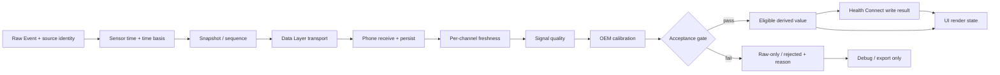

# Wear OS 健康資料完整性 QA 主控

> [!abstract] 任務與驗收
> 以可追溯證據檢查 **Raw Event → Acquisition → Snapshot → Watch→Phone Transport → Phone Persist → Freshness → Quality → Calibration → Acceptance → Health Connect → UI**。此筆記整合十個 Codex 子代理的工作分配、已交付審查與 QA 待辦。它是專案主控頁，不代表功能或醫療驗證已通過。

> [!danger] 不可跨越的資料紅線
> - 禁止補造、插值或從別的感測器冒充缺值。
> - **Raw ≠ Calibrated；Export ≠ Health Connect 寫入；Export ≠ UI 顯示。**
> - `sensor acquisition time`、手機收到時間、快照時間、匯出時間及 UI render time 必須分開。
> - 小米裝置校準、臨床驗證未公開時，不產生醫療級 SpO₂%、ECG mV、BioZ Ω 或疾病診斷。
> - 「0% 失敗／100% 準確」不是可保證的工程驗收條件；每次失敗都要可分類、可重現或明確記作未知。

## 導覽與關聯筆記

- [[wear-sensor-validation-plan|感測器逐項驗證計畫]]
- [[ACTIVE_DEBUG_TRACKER|最新裝置證據與 PM 追蹤]]
- [[sensor-data-failure-triage-20260925|故障分類與近期診斷]]
- [[chip-and-paper-review-2026-09-25|晶片邊界與論文研究]]
- [[CHIP_CALIBRATION_STATUS|校準狀態]] · [[CHIP_INVENTORY|晶片／endpoint 清單]] · [[DELIVERY_2026-09-25|QA 交付門檻]]
- 程式碼：[[mobile/src/main/java/com/jaysato/xiaomihealthbridge/WearDataProcessor.kt|手機接收管線]] · [[wear/src/main/java/com/jaysato/xiaomihealthbridge/WearControlService.kt|手錶感測服務]] · [[mobile/src/main/java/com/jaysato/xiaomihealthbridge/SensorDisplayState.kt|新鮮度與 UI 狀態]] · [[mobile/src/main/java/com/jaysato/xiaomihealthbridge/SensorSuiteDump.kt|診斷匯出]]
- 視覺工作板：[[Health Data Integrity Workboard.canvas|開啟 Obsidian Canvas]]

## 關鍵字索引

> [!info] 搜尋入口
> `Raw Event` · `SensorEvent` · `Acquisition Timestamp` · `ElapsedRealtimeNanos` · `Wall Clock` · `Snapshot` · `Phone Receive Time` · `Persist Time` · `Export Time` · `Freshness` · `Signal Quality` · `Calibration` · `OEM Calibration` · `PPG` · `ECG` · `SpO2` · `BioZ` · `Health Services` · `MeasureClient` · `PassiveMonitoringClient` · `Health Connect` · `Data Layer` · `Source Provenance` · `Timestamp Collision` · `Race Condition` · `Single Writer` · `Mutex` · `Deduplication` · `Source Conflict` · `Stale Data` · `Raw Only` · `Uncalibrated` · `Rejected` · `Accepted` · `Health Connect Write Result` · `UI Render State` · `Data Integrity` · `Release Gate`


^data-pipeline

## 十代理工作與整合

> [!note] 團隊範圍說明
> 本輪是 **10 個 Codex 本機子代理角色**，平台最多同時跑 6 個，因此分梯輪替；「十代理」不代表十家外部模型。代理未收到健康原始波形或帳號資料。網頁版 Claude/Gemini/Grok/Meta AI 等外部會話本輪沒有被宣稱已諮詢；外部模型結論不得冒充代理結果。

| 代理 | 指派角色 | 已交付的關鍵結論 | 整合狀態 |
|---|---|---|---|
| Lorentz | PM／里程碑與阻塞追蹤 | 先配對手機／手錶版本，再由 UI 做一輪掃描與兩輪不重疊複測；舊匯出不能證明新掃描。 | 已整合至真機 Gate |
| Harvey | Wear OS LOW_MEMORY／耗電程式稽核 | `LOW_MEMORY` 證明系統曾因記憶體壓力終止程序，不足以歸因為 App 洩漏；ECG 快照重複複製是待量測假設。 | 保留為待驗假設 |
| Heisenberg | 手機 Data Layer、持久化、狀態分類 | payload 超限與排序拒收共用計數；重複心率原因在 UI 未完整翻譯；failure stage 不能區分未送達與已送達後被拒。 | 已拆拒收類別；端到端待測 |
| Arendt | 通知路徑／功耗 | 手機例行通知預設關閉、靜音低優先級並節流；目前快照無活躍 app 通知，無法據此量化過去推播或耗電。 | 保留緊急與例行分流；觀測缺口記錄 |
| Descartes | 感測器家族、晶片原廠資料與論文 | Xiaomi 未公開確切 BOM；MAX86178、CT7117 等只能標為待證映射，不能當實際晶片／校準證明。研究彙整見研究筆記。 | 已產生研究筆記；引用逐項核驗 |
| Maxwell | Stage 0 QA 測試設計 | 單次只變一項條件；逐層核對註冊、事件、品質、校準、傳輸、持久化、新鮮度及 UI；LOW_MEMORY 只作觀測。 | 已整合至測試矩陣 |
| Feynman | Health Connect／UI 統計一致性 | 「今日總消耗」原讀最近 24 小時，會混入昨日；跨來源活動值直接相加可能重複計算；區間紀錄跨 DST 的 end offset 需獨立計算。 | 今日卡路里已改用今日區間 Aggregate；另兩項待處理 |
| Gödel | QA／建置／交付放行 | 手機 v3.13.12/code122、手錶 v3.13.14/code124 不一致；Release 仍用 debug 簽章；真機重複掃描、正式簽章與交付清單未通過。 | 維持 QA-only／release BLOCK |
| Archimedes | Android／Wear OS 官方文件查核 | Wear OS passive monitoring 為系統批次、非固定週期；原始 sensor 背景事件不保證；通道重要性不能證明通知曾發出。 | 已核官方連結；非本機實測 |
| Kant | 生理算法與醫療安全審核 | 睡眠分期合成、HRV 壓力分數、VO₂max、恢復時數、跌倒分類等有過度確定風險；即時心率不得直接套靜息參考帶。 | 心率結論已改成非靜息研究資料；其他列入審核 |

### 整合判斷

1. 現在最明確的資料缺口不是單一「sensor 壞掉」：註冊／事件、接觸條件、品質、校準、背景限制、Data Layer、保存、UI 都可能各自失敗；必須按層定位。
2. 近期手機匯出存在不代表手錶目前仍在線、也不證明 Health Connect 寫入或 UI 顯示。需用同一 session ID、channel/source 與測量時間串起證據。
3. 低記憶體、耗電與推播的因果關係尚未成立。需要同一觀測窗的程序記憶體、掃描狀態、通知 posted/removed、電量變化及系統記錄。
4. 晶片 datasheet 能描述晶片能力，不能替代 Xiaomi 整機 BOM、配置、感測器通道對應、校準或臨床驗證。

## 最新觀測快照

| 證據欄位 | 觀測值 | 解讀限制 |
|---|---|---|
| 手機匯出 | 2026-09-25 22:27:35 +08，38 個通道 | 匯出時間不是採集時間 |
| 匯出所記錄的全掃描 session 起點 | 2026-09-25 20:51:40 +08 | 不足以證明該時刻後每個通道都持續採集 |
| 指標狀態彙總 | fresh hardware 22；stale 1；not measured 4；condition not met 4；calibration missing 5；研究級有效訊號 1；derived 1 | Freshness 不代表品質合格或生理校準 |
| PPG／raw SpO₂／ECG／BioZ | 匯出有樣本，但狀態為校準缺失 | 不換算成醫療脈率、SpO₂%、ECG mV 或 BioZ Ω |
| Health Services 心率 | 有新鮮的獨立來源事件 | 不得刷新其他感測器的 freshness |
| ADB | 本次檢視時手機在線；手錶無線 ADB 端點離線 | 不能重新從手錶 UI 發起驗證掃描 |
| 通知 | phone 快照未見當下活躍的 HealthBridge notification record | 只能證明快照時沒有活動通知，不能證明過去從未推播 |
| 裝置建置 | 手機 3.13.12/code122；手錶 3.13.14/code124（代理與既有追蹤紀錄） | 版本不一致是重現混淆因素，需重新讀取目前安裝狀態 |

## QA 狀態詞彙

| 層級 | 可接受狀態 | 必需證據 |
|---|---|---|
| Acquisition | `NO_SENSOR`、`REGISTRATION_FAILED`、`NO_EVENT`、`CONDITION_NOT_MET`、`ACQUIRED` | 感測器候選／註冊結果、首末事件時間、callback/sample 數、終止原因 |
| Transport／保存 | `QUEUED`、`RECEIVED`、`PERSISTED`、`REJECTED`、`UNKNOWN` | snapshot/session/sequence、手錶 queued、手機收到及落盤時間、分開的拒收理由 |
| Freshness | `FRESH`、`STALE`、`UNKNOWN`、`NOT_ACQUIRED` | per sensor/channel/source 的 acquisition timestamp；不得使用 export time |
| Quality | `ACCEPTED`、`REJECTED`、`UNKNOWN`、`NOT_EVALUATED` | 品質方案/版本/原因；未知品質分數不得自行解讀 |
| Calibration | `AVAILABLE`、`MISSING`、`UNKNOWN`、`NOT_REQUIRED` | 校準來源、工程單位、換算版本與適用硬體 |
| Presentation | `AVAILABLE`、`STALE`、`RAW_ONLY`、`UNCALIBRATED`、`LOW_QUALITY`、`SYNC_PENDING`、`ERROR`、`NOT_RENDERED` | UI 每個值對應 source event、時間、狀態；匯出存在不能代替 UI 檢查 |
| Health Connect | `WRITE_PENDING`、`WRITE_SUCCEEDED`、`WRITE_FAILED`、`NOT_ELIGIBLE`、`UNKNOWN` | API 寫入成功／失敗結果與寫入時間；本機 JSON 不可當作 HC 記錄證據 |

## 逐項驗收任務

- [ ] 配對手機／手錶版號；記錄 OS/API、電量、充電、佩戴與接觸狀態。 #project/xiaomi-health #qa/data-integrity [priority:: highest]
- [ ] 手錶回到在線後，從 Wear App UI 跑一次有時限、非充電、正常佩戴掃描；保留終態與每通道時間戳。 #sensor/raw-data [priority:: highest]
- [ ] 同一 session 核對 `registration → watch event → snapshot → Data Layer → phone receive → persist → export → UI`。 #qa/data-integrity [priority:: highest]
- [ ] 重複兩輪不重疊 UI 掃描；每個 endpoint 有成功或明確失敗分類，不把未測量當成已通過。 #release/blocker [priority:: high]
- [ ] 分開測單感測器、順序掃描、配對感測器及 broad scan；同步觀測記憶體、熱度、電量與 HAL restart。 #android/wear-os [priority:: high]
- [ ] 驗證同毫秒多來源／多封包不覆蓋、不靜默丟失；保存 source ID、sequence 與原始 timestamp precision。 #qa/data-integrity [priority:: high]
- [ ] 將 `phone_receipt_unconfirmed` 與「已收到但 payload/order/duplicate 拒收」分開，增加每類計數與 session 關聯。 #qa/data-integrity [priority:: high]
- [ ] Health Connect 活動總量使用相符本地日界線及 Aggregate API；核對多來源去重策略與 UI 標示。 #android/health-connect [priority:: high]
- [ ] 修正 `StandardHealthWriter` 跨夏令時間區間記錄的 end zone offset，並加 DST 測試。 #android/health-connect [priority:: medium]
- [ ] 更新 QA 文件矛盾處：已成功的一次採集 vs. 尚未通過重複性／最終版驗收。 #release/blocker [priority:: medium]
- [ ] 量化實際通知貼出／抑制次數及能耗窗口；例行訊息需靜音、限頻、去重，緊急告警獨立保留。 #android/wear-os [priority:: medium]
- [ ] 審查睡眠分期、壓力／電量、恢復、VO₂max、跌倒、節律等演算法的輸入、來源、單位與驗證層級。 #medical-safety [priority:: high]
- [ ] 完成手機與手錶測試、lint、Release assemble、簽章／版本核對後，再更新交付紀錄；目前不宣稱臨床放行。 #release/blocker [priority:: highest]

## 標準真機測試矩陣

| 測試 | 條件只改一項 | 逐層記錄 | 通過意義 |
|---|---|---|---|
| Baseline | 配對版、佩戴、未充電、連線穩定 | sensor list、註冊、首末樣本、終態、session/sequence、phone receipt/persist、UI | 只通過採集與呈現，不代表臨床有效 |
| No sensor / register fail | 指定 endpoint | candidate metadata、register callback/error | 清楚顯示未暴露或註冊失敗 |
| No event | 註冊成功、限定時窗 | event/sample=0、stop reason | 標 `NO_EVENT`，不得沿用舊值為新值 |
| Wear/contact/charging | 每輪僅變一項 | wrist/contact/charging、skip reason | 標 `CONDITION_NOT_MET` 或明確 skip |
| Quality reject / raw-only | 有事件但品質差或無校準 | raw、quality、calibration 分欄 | 保留研究資料，不做偽生理輸出 |
| Transport / persistence | 受控連線中斷／恢復 | queued/sent/received/persisted/session/order | 精確分辨尚未到達與拒收／保存失敗 |
| Freshness boundary | 新鮮、超窗、未來時間戳 | 每個 channel 的 `age_ms` / `is_stale` | 一個 fresh metric 不刷新其他通道 |
| Repeatability | 3 次不重疊 UI 掃描 | 每次環境、版本、結果、錯誤分類 | 可重現，不代表準確率為 100% |

## 論文與官方來源

優先從 [[chip-and-paper-review-2026-09-25|逐感測器研究備忘錄]] 檢視來源。此處只列可支撐工程邊界、不能替手錶校準背書的來源：

- HRV 標準：[ESC/NASPE Task Force, Circulation 1996, PMID 8598068](https://pubmed.ncbi.nlm.nih.gov/8598068/)
- Actigraphy 臨床實務限制：[AASM Actigraphy Practice Parameters](https://aasm.org/resources/practiceparameters/pp_actigraphy_update.pdf)
- Mifflin–St Jeor 原始能量預測研究：[PubMed PMID 2305711](https://pubmed.ncbi.nlm.nih.gov/2305711/)
- Wear OS 長時間背景監測：[Health Services background monitoring](https://developer.android.com/health-and-fitness/health-services/monitor-background)
- Health Connect 聚合與來源優先：[Aggregate data](https://developer.android.com/health-and-fitness/health-connect/aggregate-data)
- Xiaomi Watch 2 Pro 公開規格：[Xiaomi specifications](https://www.mi.com/au/product/xiaomi-watch-2-pro/specs/)
- PPG 運動偽影研究、ECG 濾波、皮膚色素與血氧限制、BioZ 綜述：參見研究備忘錄；任何論文都不能證明本錶 BOM 或臨床校準。

## 專案變更紀錄

- 2026-09-25：把今日總消耗的活動熱量查詢從滾動 24 小時改為本地今日時窗 `AggregateRequest`，並新增 Mifflin–St Jeor 輸出驗證；Health Connect Aggregate API 會依活動資料來源優先序處理重複值。
- 2026-09-25：把快照拒收細分為排序、payload 大小／格式、重複心率，避免 UI 把 payload rejection 說成排序丟包。
- 2026-09-25：近期心率結論不再直接套用靜息心率參考帶；非靜息來源只顯示工程可置信度與非診斷說明。
- 2026-09-25：研究備忘錄中 SpO₂ 皮膚色素綜述 DOI 已更正並連至出版者紀錄。
- 驗證狀態：一次先前手機單元測試、手機 `lintVitalRelease` 與雙端 release assemble 已成功，但部分檢查發生於最後幾項編輯之前；需以最終內容重跑。真機掃描未完成，release gate 維持 BLOCK。

## Release Gate

```yaml
release_gate: BLOCK
verified_on_device: false
reason: "配對版本／重複真機掃描／逐層 Health Connect 與 UI 證據未完成"
```

### Dataview：未結案工作

```dataview
TABLE priority, status, updated
FROM #project/xiaomi-health
WHERE status != "done"
SORT priority ASC
```

### Dataview：本文任務視圖（需 Dataview 外掛）

```dataviewjs
const page = dv.page("Wear OS 健康資料完整性 QA");
const tasks = page?.file.tasks ?? [];
const done = tasks.filter(t => t.completed).length;
dv.paragraph(`QA 任務完成：${done}/${tasks.length}；真機 Gate：BLOCK`);
dv.taskList(tasks, false);
```

### Tasks 外掛：P0 驗收待辦

```tasks
not done
tags include #project/xiaomi-health
sort by priority
sort by due
```

## Obsidian 使用方式

- 將專案根資料夾加入 Obsidian Vault；Properties 可直接編輯 YAML metadata，標籤與 aliases 讓全庫搜尋和快速切換生效。
- 以 `[[wikilink]]`、backlinks、graph view 導航主控頁、研究、故障、測試和程式碼；區塊 ID `^data-pipeline` 可被其他筆記引用。
- 用 [[Health Data Integrity Workboard.canvas|Canvas]] 做角色與資料生命週期的空間化視圖；用 Mermaid 看資料流。
- 用 Tasks 查詢追蹤待辦；Dataview/DataviewJS 範例屬社群外掛，未安裝時仍可使用本文 checklist、tags 和 links。
- 重要證據記錄在 [[ACTIVE_DEBUG_TRACKER]]，不要只改主控頁摘要；每次掃描建立 session 對應的 evidence entry，補上來源時間、OS/app 版本及驗收狀態。

## 最終資料完整性原則

> [!quote] 不知道時就明確說不知道
> 可以回報「未暴露、未註冊、無事件、品質不足、未校準、過期、未同步、保存失敗、尚未寫入 Health Connect 或 UI 未呈現」；不能為了讓介面完整而補出一個不存在或不可證明的健康數值。

**Raw Event → Source Provenance → Acquisition Time → Snapshot → Transport → Phone Persist → Freshness → Quality → Calibration → Acceptance → Health Connect Write Result → UI Render State**

#project/xiaomi-health #qa/data-integrity #android/wear-os #android/health-connect #release/blocker
