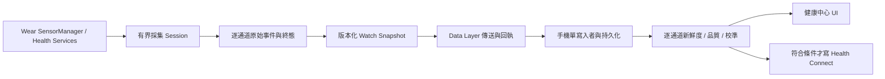

# Health Bridge 資料恢復架構與十人派工

狀態：實作與實機驗證進行中。本文定義下一版可驗證的資料契約與分工；未標為「已實作」的欄位、模組及 UI 均為待完成設計。

## 即時基線

- 手機現裝 3.13.12（code 122）；手錶現裝 3.13.14（code 124），雙端版本未對齊。
- 手機最近一次可讀匯出為 2026-09-25 22:27，掃描工作階段起於 20:51；38 通道中 22 個為新鮮硬體資料、5 個缺裝置校準、4 個條件未滿、4 個未量測、1 個陳舊、1 個研究訊號、1 個推估。這是舊匯出的分類，不代表 23:00 後的新測量。
- 23:00 前後手錶曾透過無線 ADB 連上，離開充電座後確認 USB 供電為 false；喚醒並讀取 UI 時 ADB 轉為 offline。新一輪端到端掃描尚未完成，不能宣稱數值已恢復。
- 手錶退出紀錄含 `LOW_MEMORY`，尚無足夠堆積與記憶體證據可歸因至某段 App 程式。

## 最小可用資料流

每筆通道結果至少保留 `session_id`、`channel_id`、`source`、`sensor_timestamp` 與其時鐘基準、`watch_snapshot_at`、`phone_received_at`、`phone_persisted_at`、`sample_count`、`unit` 或 `raw_only`、`quality_state`、`calibration_state`、`terminal_reason`。同毫秒但不同來源不得視為同一事件；匯出時間不得刷新量測時間。手機 UI 和匯出共用同一狀態判斷。

終態：`fresh`、`stale`、`no_event`、`condition_not_met`、`permission_denied`、`transport_failed`、`payload_rejected`、`quality_rejected`、`calibration_missing`、`cancelled`、`unsupported`。所有實際採集欄位都應能到達其中一個可追溯終態；不以假值填補。

## 現有程式對接點

| 責任 | 現有入口 | 本輪驗收輸出 |
| --- | --- | --- |
| 手錶採集與快照 | `wear/.../WearControlService.kt`、`AdvancedSensorController.kt` | 每通道採集時間、事件數、終態、清理結果 |
| 背景心率與排程 | `PassiveRegistrationWorker.kt`、`PassiveHealthService.kt`、`WearPowerScheduler.kt` | 註冊狀態、使用者偏好、實際回報時間、耗電計數 |
| 手機接收與寫入 | `mobile/.../WearDataProcessor.kt` | 分來源順序、拒收分類、保存確認 |
| 匯出與顯示 | `SensorSuiteDump.kt`、`SensorDisplayState.kt`、`HealthCenterActivity.kt` | 相同來源與新鮮度、可見的錯誤原因 |
| Health Connect | `HealthConnectRecordReader.kt` 與各 Writer | 寫入嘗試及成功結果，避免多來源重複計算 |

## 十個外部 AI 的獨立審查任務

### 2026-09-25 23:12 實機掃描追蹤

- 手錶已離充電，`192.168.0.16:43803` 無線 ADB 可連，但反覆短暫離線；從手錶前景量測頁成功啟動 `WearControlService` 全掃描。
- 手機匯出時間 23:12:03，控制回報時間 23:12:00，回報 20/26 階段有樣本、目錄 22/36 通道有原始事件；這是新的回報，不是 20:51 的舊掃描。但匯出頂層 `sensor_suite_session_started_at_epoch_ms` 仍為 20:51:40，須修正其與逐通道 session 不一致問題。
- 38 個目錄項中，21 個有新鮮非診斷性硬體資料、10 個未量測、4 個條件不滿足、1 個過期、1 個衍生估計、1 個研究用途原始資料；新鮮數量不等於臨床可用。
- 離腕感測器已註冊且回傳單一事件 `0`，目前程式判為未貼合；使用者表示已戴上。此為使用情境與硬體回報衝突，需複測和檢查感測語意，不能直接強制改為佩戴合格。PPG、ECG、BioZ、SpO₂ 原始與光學心率因此本輪未量測。
- 手機仍停在鎖定／通知畫面；手機健康中心 UI 尚未前景驗證。優先完成第二輪佩戴狀態複測、核對離腕事件，再修 session 對齊與顯示。
- 23:14:44 第二輪全掃描完成，19/26 階段有樣本、21/36 通道有原始事件；離腕感測器仍僅一筆 `0`，判為未貼合。這是可重現的條件阻斷，不能視為全通道復原。
- `WearDataProcessor.kt` 已補上接受「全感測器掃描開始」控制訊息時更新手機端全掃描 session 時間；`mobile:testDebugUnitTest` 通過。後續已覆蓋安裝，23:21 的新掃描驗證了時間更新。
- 後續單獨 PPG 研究量測在離腕狀態仍收到 8 個事件、28 個樣本，證明全掃描「離腕即略過全部接觸通道」會掩蓋可採的原始資料。Android [SensorEvent 官方規格](https://developer.android.com/reference/android/hardware/SensorEvent) 定義離腕感測器 `0` 為 off-body、`1` 為 on-body；程式映射沒有顛倒。不能以 PPG 原始事件反證佩戴合格或宣稱醫療可信。
- 已改手動全掃描：即使回報離腕，仍逐項有界採集接觸通道原始資料，但維持 `wornQualified=false`，不以此執行生理校正。雙端同簽章覆蓋安裝後，23:21:47–23:24:25 實機全掃描回傳 25/34 階段有樣本、27/36 通道有原始事件；PPG 8 事件、MAX 光學心率封包 488、SpO₂ 原始 487、ECG 220、BioZ 430。五項仍標示缺校準，不能當作醫療數值。頂層 session 時間已正確更新。
- 手錶掃描前後電量顯示 75%；僅為粗略短時觀察，不能據此判定耗電已改善。掃描後有限錯誤級別 log 未見本 App 崩潰，但需更長期的耗電與通知驗證。
- 獨立 code review 指出離腕時 Health Services 心率仍可能寫入健康紀錄，以及掃描開始控制訊息亂序時 session 時間可能保留舊值；兩者已修正。手機安全通知新增事件時間去重與過期限制，跌倒取消事件會清除手機警示，不受日常通知設定阻擋。
- 修正後 `:wear:testDebugUnitTest :mobile:testDebugUnitTest :wear:assembleDebug :mobile:assembleDebug` 通過，手機與手錶均以同簽章 `adb install -r` 覆蓋安裝。這批最後審查修正尚未再跑完整實機掃描；醫療校準、長期耗電與通知仍未驗收。
- 23:32:25–23:35:03 再次於最新版完成全掃描：25/34 階段有樣本，27/36 通道有原始事件，PPG 8、MAX 光學封包 487、SpO₂ 原始 487、ECG 219、BioZ 418 事件；各通道 session 均屬本輪。手機頂層 session 已更新為 23:32:25。離腕仍為 `0`，上述資料維持研究用原始資料／缺裝置校準，沒有醫療數值驗收。這證明採集與雙端傳輸恢復，但不證明所有通道成功或診斷準確。

外部 AI 只接收匿名化問題與架構摘要；答案須以原始碼、官方文件與實機驗證，不能直接當作修正完成。Codex 擔任整合與最終主審。

| # | 審查者 | 唯一交付 |
| --- | --- | --- |
| 1 | Claude | 手錶採集失敗根因、反證、最小修正順序 |
| 2 | ChatGPT | 手機接收、排序、拒收與 UI 管線測試矩陣 |
| 3 | Gemini A | 原始感測器逐項能力與採集條件矩陣 |
| 4 | Gemini B | 背景間隔與連續模式的耗電生命週期 |
| 5 | Gemini C | Health Connect 與逐通道 UI 資料契約 |
| 6 | Grok | Android 系統記憶體、耗電與通知的反方歸因 |
| 7 | Meta AI | 手錶圓形小螢幕及手機健康中心 UX |
| 8 | DeepSeek | Data Layer、背壓、單寫入者與重送策略 |
| 9 | Kimi | 晶片原廠資料和可驗證論文查核 |
| 10 | Gemini D | 雙端版本、實機掃描與 code review 的交付門檻 |

## 實作順序與完成證據

1. **P0 新資料**：手錶穩定連線、離充電且佩戴時，從 App UI 啟動一次掃描；截取每通道新取樣時間和終態。重複 2–3 次，不把舊匯出當新資料。
2. **P0 雙端契約**：對齊安裝版本，辨明 watch event、Data Layer、phone receipt/persist、UI 的每段是否成功。優先修最早失敗的一段。
3. **P1 功耗與通知**：量測掃描前後活動感測器、WakeLock、通知投遞與電量；使用者可選間隔採集要標明 OS 無法保證精確背景時間，連續模式限制在可見且有界的前景工作階段。
4. **P1 醫療邊界**：有原始波形但沒有裝置校準時，提供專業研究波形和訊號品質，不輸出虛構 ECG mV、SpO₂% 或疾病診斷。
5. **驗收**：雙端單元測試、release lint/build、完整 code review、真機逐項和重複掃描、手機 UI 與 Health Connect 對照。只有測到的項目標成完成。
